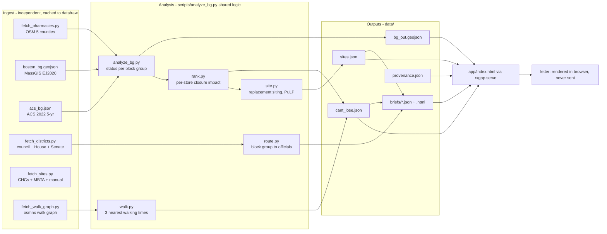

# Design Document

## Overview

RxGap is an offline batch pipeline plus one local web page.

- Python scripts ingest raw data once into `data/raw/` and compute every number into
  `data/*.json`. Nothing on screen is computed from scratch in the browser.
- The page (`app/index.html`, Leaflet, see "UI and visualization") reads those JSON
  files. A closure click is a lookup in precomputed results, so it redraws instantly
  (Req 3.1, under 5 s).
- A tiny local server (`python -m rxgap.serve`, 127.0.0.1 only) serves the page and keeps
  anonymous letter counts (Req 7).
- `python -m rxgap.check` reruns the pipeline from `closures.csv` and prints what changed
  (Req 10), for the Crew daily job.

Method: HPC DataPoints 31. All distance and area math in EPSG:26986.

## Architecture



## Components

### Ingest (Phase 1, all independent, run in parallel)

| Script | Source | Output | Fallback |
|---|---|---|---|
| `fetch_pharmacies.py` (exists) | Overpass, `amenity=pharmacy` + `healthcare=pharmacy`, 5 counties | `raw/pharmacies.json` | Retries on 502; keep last cache |
| block groups (exists) | MassGIS EJ2020, `MUNICIPALITY='Boston'` | `raw/boston_bg.geojson` | Cache |
| ACS (exists, in `analyze_bg.py`) | B25044, B01001, B17017 | `raw/acs_bg.json` | Income-below-median rule, shown on screen (Req 1.2) |
| `fetch_districts.py` | Council districts: Boston OpenData (found via MCP). House/Senate: MassGIS 2021 districts | `raw/council.geojson`, `raw/house.geojson`, `raw/senate.geojson` | Hand-made `manual/officials.csv` for demo districts |
| `fetch_sites.py` | MassGIS community health centers, MBTA rapid transit stations, `manual/candidate_sites.csv` | `raw/sites.json` | Manual CSV only |
| `fetch_walk_graph.py` | `osmnx.graph_from_place('Boston')` + 1 mi buffer, `network_type='walk'` | `raw/walk.graphml` | Straight-line distance × 1.3, labeled "estimate" |
| `fetch_npi.py` (cut first) | NPI Registry, rapidfuzz match on name + address | `source` field on each pharmacy: both / OSM only / NPI only | Label all "OSM only" |

`manual/officials.csv`: `district_type, district_id, name, email, office_address`.
Hand-filled from official city and state pages; each row keeps a `source_url`.

### Analysis

**Coverage** (`analyze_bg.status_at`, exists). For a block group, union the walk-limit
buffers of nearby open pharmacies, take the covered share of its area. Under 15% is a
desert. Otherwise, if dropping any one pharmacy pushes it under 15%, it is a near-desert.

**Per-store impact** (`rank.py`, exists). For each pharmacy, recompute only block groups
within its reach (Req 2.2). Result per store: lost block groups, people, 65+, no-car
households. This same table powers the closure simulation, so there is one source of truth.

Extend each store record with, per lost block group:
- `nearest`: three nearest remaining pharmacies with walking minutes (`walk.py`,
  shortest path on the cached graph, 1.33 m/s, from the block group's representative
  point). Only lost block groups need routing, so this is small (under 100 block groups).
- `districts`: council, House, Senate (`route.py`).
- `address`: reverse lookup from OSM tags; else "address not in OSM".

**Closure simulation** (Req 3). One closure on top of today's baseline is exactly a
store's precomputed record. The page just swaps statuses. A closure added to
`closures.csv` goes through the full pipeline (hook + `rxgap.check`). Two closures at once
in the browser is out of scope; the page says so.

**District routing** (`route.py`, Req 4.1). Assign each block group to the district that
holds the largest share of its area. The brief lists block groups that split across
districts, so no one is silently dropped.

**Replacement siting** (`siting.py`, Req 5).
1. Candidates within 2 mi of the lost block groups.
2. For each candidate, add it as a pharmacy and rerun `status_at` on the lost block groups.
   A block group is restored when it is no longer a desert. Gain = people restored.
3. PuLP max-coverage picks the best set of up to 3 (binary `x_site`, `y_bg <= sum x` over
   sites that restore it, maximize `sum pop * y`). This catches pairs that cover
   different areas.
4. Output per site: gain, restored block groups, and the covered share before/after for
   each, which is "the math" shown on screen (Req 5.2).

Fallback (Req 5.3): nearest health center to the lost population's center, gain computed
the same way.

### Text: briefs and letters (Req 4, 6, 8)

One rule: **text comes from templates, numbers come from a facts dict.**

- `data/templates/brief.en.md`, `data/templates/letter.{en,es,ht}.md`, more languages if
  time allows. Written and reviewed once at build time. Placeholders only, like
  `{people_lost}`, `{site_1_name}`, `{walk_min_1}`. A template may not contain a digit;
  a test enforces it.
- `render(template, facts)` fills placeholders. Numbers are formatted by code
  (`f"{n:,}"`), the same way in every language.
- Brief: one per affected official, from `briefs/{district_id}.json` (facts) rendered to
  HTML. Shows lost block groups, the three nearest stores, top sites, letter count.
- Letter (in the browser): resident enters an address → geocode → point-in-district →
  show their officials to confirm (Req 6.1). Resident must type one sentence before the
  letter appears (Req 6.3). Output: chosen language + English copy, a Copy button and a
  `mailto:` link the resident opens themselves. Nothing is sent by the app (Req 6.4).
- Geocoding: the US Census geocoder (free, no key). Fallback: pick your block on the map.
- Footer on every brief and letter: "AI tool built at Hackachusetts. Not the City of
  Boston."

**Policy facts** (Req 13, 14): `data/manual/policy.json`, hand-made, one row per fact:
`id, statement, value, cite, url, confirmed` (date last confirmed at the source). Seed rows:
no MassHealth rides to pick up medicine (130 CMR 407.411(9), appeal 2310153); rides to a
pharmacy for a vaccine are covered (same appeal); PT-1 is filed only by a provider, online,
up to 3 business days (MassHealth rides page); MassHealth delivery add-on up to $8 (Pharmacy
Facts 167, confirmed 2021 only); store closure notice is 14 days (247 CMR 6.13). The
MassHealth letter's recipient and address also live here, with a source URL.

**Delivery helper** (Req 13): a panel opened from the block sheet and the closure card.
No input fields. It reads the chosen block's three nearest open stores (name, address,
phone when OSM has a `phone` tag) and renders `help.{en,es,ht}.md`: four ways (store
delivery, plan mail order, synced 90-day fills, vaccine ride), a phone script, a doctor
checklist, and a Print button. Policy facts render from `policy.json` with a source link and
"last confirmed" date. Nothing leaves the browser.

**MassHealth letter** (Req 14): a second topic in the letter flow. Step 1 still finds the
resident's officials (for the copy line); step 2 picks the topic, "Replace the store" (to
officials) or "Pay for pharmacy rides or delivery" (to MassHealth). Template
`letter_masshealth.{en,es,ht}.md`; facts: place desert and near-desert residents, 65+ and
no-car counts, the resident's block status, and the rule citation from `policy.json`.

**Number integrity** (Req 8): `tests/test_integrity.py` renders every brief and a sample
letter per language, pulls every number out of the output, and fails unless each one is in
the facts dict, which in turn must match `cant_lose.json` / `sites.json`.

### Letter counts (Req 7)

`rxgap.serve` exposes `POST /count {district_id}` and `GET /counts`. It stores only
`district_id, date, count` in DuckDB (`data/letters.duckdb`). The browser calls it when
the resident clicks Copy or the mailto link. No names, addresses or text are sent.

Security note: the server has no login. It binds to 127.0.0.1 only and accepts only a
known `district_id`. For a public deploy this would need auth and rate limiting.

### Validation line (Req 9)

Shown under the headline: "We count {desert_pop} people in deserts. The Boston Globe
reported about {globe_pop} (2024)." Followed by a fixed explanation written before we
compare, listing the known differences:
- area-share rule (15% of block group area) vs. distance from a point;
- 0.5 mile limit for low-access block groups, which covers about half of Boston;
- OSM pharmacy list and closures through today vs. their date;
- block-group population vs. their unit.

The Globe's exact method is still to be checked from the article; until then the page
says "their method may differ" rather than guessing.

### Provenance (Req 12)

`data/provenance.json` maps each number key to `{function, dataset, pulled}`. Every
script that writes a number also writes its entry. Pull dates come from the cache file's
fetch time. On screen, each number has a small "how we got this" link that opens its entry.
A test fails if a number key on screen has no provenance entry.

### Daily check (Req 10) and verify (Req 11)

- `rxgap/check.py`: run `analyze_bg` + `rank`, compare `s_state` with
  `data/last_status.json`, print changed block groups (GEOID, old → new, people,
  officials), then save the new snapshot. Exit 0 always; output empty when nothing changed,
  so the Crew job posts only on change.
- `scripts/verify_numbers.py`: recompute desert / near-desert / covered population from
  `data/raw/` without reading any output file, and assert it matches the headline.

## UI and visualization

Polish and interactivity are a judged feature, not a final coat. The demo is the closure
moment, so that one interaction gets the most care.

### Stack

- **Leaflet 1.9.4 with SVG paths** (vendored in `app/vendor/`). MapLibre GL was tried first
  and dropped: it needs WebGL, and Chrome on the demo Mac could not create a WebGL
  context, so the map stayed blank. Smooth color changes come from CSS transitions on
  the SVG paths, so all map colors still live in `tokens.css`.
- Base map: Esri World Light Gray raster tiles (no key), labels drawn above the data.
  Offline, the data still draws on a plain background.
- Plain HTML, CSS and one ES module. No build step, no framework.
- Design tokens (colors, type, spacing, motion) in one file, `app/tokens.css`. No colors
  anywhere else.
- folium is used only for the static mini-map printed in each brief.

### Layout

```text
+--------------------------------------------------------------+
| RxGap   [Risk map] [Officials] [Write a letter]     (i) method |
+------------------+-------------------------------------------+
| Headline         |                                           |
|  132,087 in      |                 MAP                       |
|  deserts  (i)    |   blocks: desert / near / covered         |
|                  |   stores: dots, ranked ones larger        |
| Can't-lose list  |                                           |
|  1 CVS  24,080 > |                        [legend] [slider]  |
|  2 Sullivan's  > |                                           |
|  ...             |          bottom sheet: block details      |
+------------------+-------------------------------------------+
```

- Left panel: headline numbers, then the ranked list. Hovering a row lights up its
  store and the blocks it holds up on the map.
- Map fills the rest. Clicking a block opens a bottom sheet (not a popup) with its
  people, 65+, no car, limited English, and the three nearest stores with walk times.
- Phone width: panel becomes a pull-up sheet. The letter flow is phone-first, since
  residents use it.

### The closure moment (Req 3)

1. Click "Simulate closure" on a store row or map dot.
2. The store dot shrinks and turns gray.
3. Blocks it held up fade to red in about 0.6 s, one wave outward from the store.
4. The camera eases to fit the lost blocks.
5. A results card slides in: people cut off, 65+, homes without a car, limited English,
   the officials affected, and "Open brief" / "Best replacement site".
6. "Undo" restores the map the same way in reverse.

Number counters ease from the old value to the new one. The last frame is always the
exact code-produced value, and the counter is skipped under reduced motion.

### Other screens

- **Siting**: candidate sites as outlined pins; the best 3 are numbered. Selecting one
  shows its walk-limit ring and turns restored blocks back from red, with a before/after
  table of covered share (the "math", Req 5.2).
- **Brief**: a clean one-page view with a print stylesheet (US Letter). Headline, mini-map,
  lost blocks table, top sites, letter count. "Print / Save as PDF" button.
- **Letter**: 3 steps with a progress bar: (1) address → confirm officials, (2) language
  and your own sentence, (3) side-by-side letter and English copy with Copy and "Open in
  my email". The banner "AI tool built at Hackachusetts, not the City of Boston" stays
  visible on every step.
- **Method**: a short page with the HPC rule, sources and pull dates, and the
  Globe comparison (Req 9).

### Visual rules

- Status colors are color-blind safe and also differ by pattern: desert = solid deep red,
  near-desert = amber with fine hatch, covered = pale teal at low opacity so the city
  doesn't look like a quilt.
- One sans-serif family (Inter or system UI), tabular numbers for all figures.
- Motion 150-600 ms, ease-out; respect `prefers-reduced-motion`.
- "How we got this" is a small (i) next to each number that opens a popover with
  function, dataset and pull date (Req 12). Source labels ("OSM, floor not truth") sit in
  the legend.

### Accessibility

- Every map action also works from the list with the keyboard.
- Text contrast at least 4.5:1, focus rings visible.
- The results card is an ARIA live region, so screen readers hear who lost access.

### Effort

UI moves from "60 min for screens 1-2" to the biggest block of the day. Order: tokens and
layout, closure moment, block sheet, siting view, brief print view, letter flow. If time
runs short, cut motion polish on the secondary screens first, never on the closure
moment.

## Data Models

```text
bg_out.geojson feature.properties
  GEOID, hood, pop, low_access, lim_eng, nocar_pct, age65,
  s_state, s_0.25 .. s_2  (slider), council, house, senate

cant_lose.json stores[]
  rank, name, address, lat, lon, source, people, age65, nocar_hh, hoods,
  lost[]: { GEOID, pop, age65, nocar_hh, lim_eng, districts{}, nearest[3]{name, walk_min} }

sites.json  by store rank
  candidates[]: { name, kind, lat, lon, gain, restored[]: {GEOID, share_before, share_after} }
  best_set: [site names], best_set_gain

provenance.json  { number_key: { function, dataset, pulled } }
```

## Package layout

Shared logic stays in `scripts/analyze_bg.py` (per steering). A thin `rxgap/` package
exists only for the two entry points: `rxgap/check.py` and `rxgap/serve.py`.
`structure.md` gets one line for it.

## Error handling

| Failure | Behavior |
|---|---|
| Overpass 502 / timeout | Retry 3×, then use cache; page shows cache date |
| Census key missing or bad | Income rule; banner names the rule in use |
| District download fails | `manual/officials.csv` for demo districts |
| Walk graph missing | Straight-line × 1.3, labeled "estimate" |
| Geocoder down | Click-the-map fallback |
| PuLP / siting cut | Nearest health center, same gain math |

No API is called at page load. Every fetch result is cached first.

## Testing Strategy

- **Unit**: `status_at` on synthetic squares (0 stores, one store, two overlapping
  stores) gives desert / near-desert / covered as expected.
- **Consistency** (exists): ranking sums to near-desert population; each near-desert block
  group is claimed by at least one store; 580 block groups.
- **Simulation**: for the top 3 stores, the precomputed lost set equals a full rerun of
  `analyze_bg` with that store added to closures.
- **Siting**: a candidate placed at a lost block group's center restores it.
- **Integrity** (Req 8): every number in rendered briefs and letters is in the facts;
  templates contain no digits.
- **Provenance** (Req 12): every on-screen number key has an entry.
- **UI smoke**: a headless browser loads `app/index.html`, simulates closing the top store,
  and checks the results card shows the same people count as `cant_lose.json`.
- **Letters**: no rendered letter path calls any send function; output always includes
  the English copy and the Hackachusetts disclaimer.
